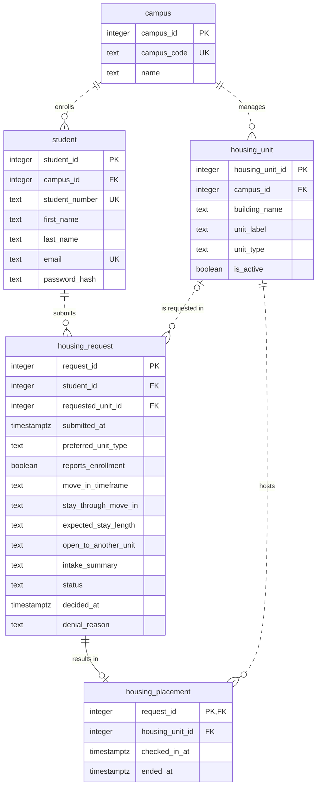

# Student Housing ER Diagram

**PK** means primary key, **FK** means foreign key, and **UK** means unique key.

- A student can have one pending request at a time. Each unit can have one active placement at a time.
- New requests select a specific unit. Older records may store only a room type preference.
- Approval creates a placement using the request ID. A denial keeps the reason on the request.
- Student email is unique regardless of case. Each campus, building, and unit label combination identifies one housing unit.

[PostgreSQL schema](database.sql) · [Database design](DATABASE_DESIGN.md) · [UML diagram for class](Housing-ER-Model.svg)
